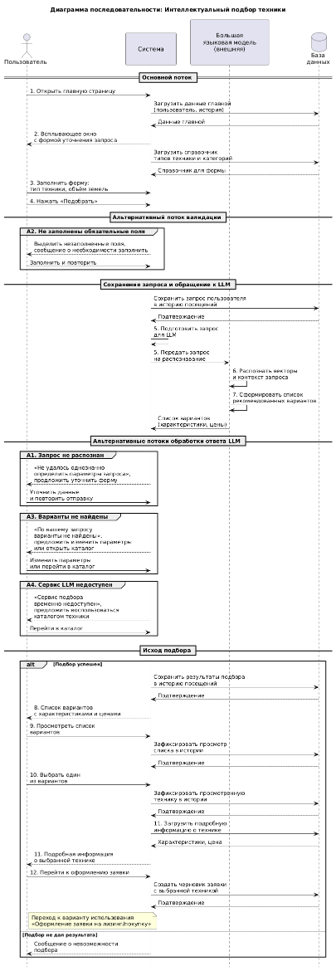

# Общий отчёт по проекту RAC-system

Практическая работа № 4 по программной инженерии. Цель - организовать репозиторий проектных материалов, обеспечить навигацию по отчётам и проверяемость вклада участников.

## Оглавление

- [Назначение продукта и репозиторий](#назначение-продукта-и-репозиторий)
- [Структура репозитория](#структура-репозитория)
- [Требования](#требования)
- [Варианты использования и UML](#варианты-использования-и-uml)
- [Индивидуальный вклад](#индивидуальный-вклад)
- [Проверка и вывод](#проверка-и-вывод)

Общий отчёт - [версия Word](report.docx). Индивидуальный отчёт Ивана Терпугова - [Markdown](md/terpugov-report.md) и [Word](doc/terpugov-report.docx). Word-версии подготовлены для сверки перед сдачей.

## Назначение продукта и репозиторий

RAC-system - веб-система подбора сельскохозяйственной техники для фермеров и агрохолдингов. По виду техники и объёму обрабатываемых земель система подбирает рекомендации с помощью языковой модели. Предусмотрены каталог, история работы, связь с дистрибьюторами и переход к оформлению покупки или лизинга. Пользователь работает с каталогом и подбором, администратор управляет учётными записями, каталогом, уведомлениями и интеграциями.

Проект размещён в публичном [репозитории RAC-system на GitHub](https://github.com/ivanivan48/RAC-system). Площадка поддерживает Git, тематические ветки, историю изменений и согласование через Pull Request.

## Структура репозитория

| Раздел | Назначение |
|---|---|
| [Исходные материалы](../source-material/README.md) | Происхождение требований, сценариев и задания |
| [Документация](README.md) | Общий и индивидуальные отчёты, исходники и изображения UML |
| [Программная часть](../projects/README.md) | Структура каталогов для реализации и её документации |
| [Модули](../modules/README.md) | Планируемые компоненты |
| [Проверки](../tests/README.md) | Проверка материалов и будущие тесты |
| [Команда](../teams/README.md) | Участники и зоны ответственности |

Markdown служит рабочей версией отчётов. После согласования из него обновляются Word-версии. Исходник и изображение диаграммы обновляются вместе. Подробности приведены в [правилах работы](../CONTRIBUTING.md).

## Требования

Общие функциональные требования по ПЗ № 1.

| Номер | Требование | Описание |
|---|---|---|
| ФТ-01 | Авторизация пользователей | Система должна предоставлять зарегистрированным пользователям возможность авторизации с использованием индивидуальных учетных данных. Авторизация выполняется с помощью логина (электронной почты) и пароля. Предусмотрена валидация введённых данных и восстановление пароля через электронную почту. При неправильном вводе пароля система должна уведомлять пользователя. |
| ФТ-02 | Разграничение прав доступа | Система должна предоставлять пользователям доступ к функциям в соответствии с назначенной ролью (администратор или обычный пользователь). |
| ФТ-03 | Ограничение сессии | Время сессии пользователя составляет 1,5 часа. По истечении этого времени система должна предлагать возможность продолжить сессию. |
| ФТ-04 | Регистрация и обработка персональных данных | При регистрации система должна запрашивать электронную почту, ФИО и согласие на обработку персональных данных. Должны быть предусмотрены финансовые защитные механизмы. |
| ФТ-05 | Интеллектуальный подбор техники | Система должна использовать большую языковую модель, распознавание векторов и модель распознавания контекста для подбора техники. Пользователь указывает, какую технику хочет и какой объём земель обрабатывает. Система предлагает варианты техники. |
| ФТ-06 | Каталог техники | Система должна предоставлять каталог сельскохозяйственной техники с фильтром категорий для сокращения диапазона поиска товаров или услуг. |
| ФТ-07 | Всплывающее окно для уточнения запроса | На главной странице должно отображаться всплывающее окно с формой для уточнения запроса пользователя. |
| ФТ-08 | История посещений и просмотренной техники | Система должна сохранять информацию о том, какую технику пользователь подбирал и для каких целей, а также историю посещений. |
| ФТ-09 | Система уведомлений | Система должна обеспечивать уведомление пользователей о важных событиях. |
| ФТ-10 | Лизинговый сервис | Система должна поддерживать закупку и аренду техники, а также любое финансовое взаимодействие бизнеса. |
| ФТ-11 | Обновление цен | Обновление цен должно осуществляться через источники дистрибьюторов посредством API или базы данных. |
| ФТ-12 | Чат обратной связи | Система должна предоставлять чат для обратной связи. |
| ФТ-13 | Обучающие материалы | Система должна содержать обучающие материалы для новых пользователей. |
| ФТ-14 | Опрос фермеров | Система должна обеспечивать проведение опросов фермеров. |
| ФТ-15 | Прямое сотрудничество с дистрибьюторами | Система должна обеспечивать прямое сотрудничество с дистрибьюторами через API или БД. |
| ФТ-16 | Перенаправление на менеджера | После выбора и покупки техники система должна перенаправлять пользователя на менеджера и обеспечивать связь с дистрибьютором. |
| ФТ-17 | Удержание пользователей | Система должна предусматривать механизмы удержания пользователей (решение проблемы ухода пользователя). |
| ФТ-18 | Обработка ошибок при финансовых операциях | Система должна предусматривать возврат денег или подобные сценарии при ошибках работы системы при договоре покупки. |
| ФТ-19 | Проверка качества данных | Система должна обеспечивать проверку качества данных. |
| ФТ-20 | Многоязычность | Система должна поддерживать несколько языков интерфейса. |
| ФТ-21 | Адаптивность отображения | Отображение списка должно зависеть от размера экрана: на ноутбуке – список, на смартфоне – плитка. |

Для администратора предусмотрены управление пользователями, каталогом и категориями, обучающими материалами, уведомлениями, интеграциями и качеством данных. Необходимость технической поддержки после сдачи подлежит уточнению. Для обычного пользователя предусмотрены регистрация и авторизация, подбор и каталог техники, история и уведомления, лизинговый сервис, обратная связь, обучение и продление сессии.

Нефункциональные требования охватывают понятность и единообразие интерфейса, зелёную цветовую схему, адаптивность и русский и английский языки (6.1). Предусмотрены собственная серверная часть, отказ от облачного размещения и масштабируемость (6.2), согласие на обработку данных, проверка ввода, восстановление пароля и ограничение сессии в 1,5 часа (6.3), получение цен через API или БД и применение языковой модели (6.4). В ПЗ № 1 также указан срок разработки три месяца и отмечена возможная потребность в сопровождении (6.5).

## Варианты использования и UML

| Сценарий | Требования по таблице ПЗ № 3 | Диаграмма | Автор |
|---|---|---|---|
| UC-01 Регистрация пользователя | ФТ-01, ФТ-04 | SD-01 | Гутов Руслан |
| UC-02 Авторизация пользователя | ФТ-01, ФТ-02, ФТ-03 | SD-02 | Золотухина Алина |
| UC-03 Восстановление пароля | ФТ-01, НФТ-6.3.2 | SD-03 | Кретов Иван |
| UC-04 Интеллектуальный подбор техники | ФТ-05, ФТ-07, ФТ-08 | [SD-04](draw/sd-04.puml) | Терпугов Иван |
| UC-05 Работа с каталогом техники | ФТ-06, ФТ-08, ФТ-22 | SD-05 | Улакин Никита |

В ПЗ № 1 адаптивность отображения имеет номер 21. В ПЗ № 2–3 для UC-05 указан номер ФТ-22. Обе исходные ссылки сохранены до согласования исправления.

В UC-04 пользователь вводит вид техники и объём земель. Система передаёт заполненный запрос языковой модели, показывает рекомендации с ценами и характеристиками и сохраняет результат подбора. Для нераспознанного запроса предусмотрено уточнение. Если варианты отсутствуют или модель недоступна, пользователь может открыть каталог. При незаполненных полях система запрашивает данные до обращения к модели.

Рисунок 1 – Диаграмма последовательности SD-04 «Интеллектуальный подбор техники».

Подробный сценарий и проверка потоков приведены в [индивидуальном отчёте](md/terpugov-report.md). Изображение и исходник SD-04 восстановлены по UC-04 и таблице соответствия ПЗ № 3. Исходники и изображения остальных диаграмм добавляются их авторами.

## Индивидуальный вклад

| Участник | Выполненная часть | Файлы |
|---|---|---|
| Гутов Руслан | UC-01 и SD-01 по материалам ПЗ № 2–3 |  |
| Золотухина Алина | UC-02 и SD-02 по материалам ПЗ № 2–3 |  |
| Кретов Иван | UC-03 и SD-03 по материалам ПЗ № 2–3 |  |
| Терпугов Иван Андреевич, ДЭ 22-24, ivanivan48 | UC-04, SD-04, оформление своей части ПЗ № 4 | [Markdown](md/terpugov-report.md), [Word](doc/terpugov-report.docx), [PlantUML](draw/sd-04.puml) |
| Улакин Никита | UC-05 и SD-05 по материалам ПЗ № 2–3 |  |

## Проверка и вывод

При проверке материалов нужно убедиться, что относительные ссылки открываются после клонирования, диаграмма читается, а текст, таблицы и рисунки совпадают в Markdown и Word. Командная проверка в Pull Request и проверка итоговой ветки выполняются после публикации.

Структура репозитория позволяет найти требования, проследить их связь со сценариями и UML и перейти к отчёту участника, подготовившего соответствующий материал.
