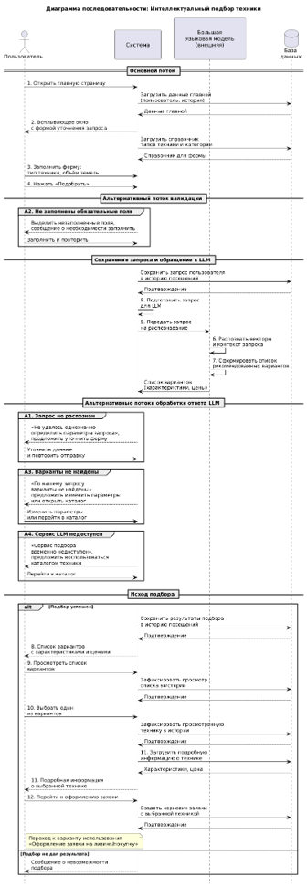

# Индивидуальный отчёт по практической работе № 4

**Проект:** RAC-system  
**Выполнил:** Терпугов Иван Андреевич, группа ДЭ 22-24  
**Учётная запись:** [ivanivan48](https://github.com/ivanivan48)

Цель работы — оформить материалы интеллектуального подбора техники в репозитории RAC-system и обеспечить проверяемость связи между требованиями, сценарием и UML-диаграммой.

## Постановка задачи

Вариант использования UC-04 описывает интеллектуальный подбор сельскохозяйственной техники. Акторы — авторизованный пользователь (фермер или представитель агрохолдинга) и большая языковая модель как внешняя по отношению к системе подбора. Предусловие — пользователь авторизован и находится на главной странице.

## Связь с требованиями

| Требование | Связь с UC-04 |
|---|---|
| ФТ-05 «Интеллектуальный подбор техники» | Рекомендации по виду техники и объёму обрабатываемых земель |
| ФТ-07 «Всплывающее окно для уточнения запроса» | Отображение формы подбора на главной странице |
| ФТ-08 «История посещений и просмотренной техники» | Сохранение запроса и результатов подбора |

## Основной поток

1. Пользователь открывает главную страницу. RAC-system показывает всплывающую форму подбора.
2. Пользователь указывает вид техники и объём земель, затем нажимает «Подобрать».
3. Система передаёт заполненный запрос языковой модели. Модель распознаёт векторы и контекст запроса и формирует список рекомендаций.
4. Система показывает варианты с характеристиками и ценами. Пользователь просматривает список и выбирает интересующую позицию.
5. Система показывает подробную информацию о выбранной технике. Пользователь может перейти к оформлению заявки на лизинг или покупку либо продолжить подбор.

После успешного подбора запрос и рекомендации сохраняются в истории посещений.

## Альтернативные потоки и проверка

| Поток | Условие | Ожидаемое поведение |
|---|---|---|
| A1 | Модель не распознала параметры | Система просит уточнить запрос. Пользователь исправляет его и отправляет повторно |
| A2 | Обязательные поля не заполнены | Система выделяет незаполненные поля. Запрос в модель не отправляется |
| A3 | Подходящие варианты отсутствуют | Система сообщает об отсутствии вариантов и предлагает изменить параметры или открыть каталог |
| A4 | Сервис модели недоступен | Система сообщает о временной недоступности подбора и предлагает открыть каталог |

Проверка на этапе проектирования состоит в сопоставлении основного потока, A1–A4 и постусловий с диаграммой SD-04. Для успешного потока проверяются выдача списка, переход к сведениям о технике и сохранение результата в истории. Ожидаемое поведение подлежит проверке после реализации.

## Диаграмма последовательности SD-04

Рисунок 1 – Диаграмма последовательности SD-04 «Интеллектуальный подбор техники».

Диаграмма восстановлена по тексту UC-04 и таблице соответствия ПЗ № 3. [Редактируемый исходник PlantUML](../draw/sd-04.puml).

## Результат и индивидуальный вклад

Подготовлены описание UC-04, таблица проверки потоков и редактируемая версия SD-04. Материалы связаны с [общим отчётом](../README.md). Ссылка на коммит и Pull Request добавляется после их создания.

## Вывод

Для UC-04 определены участники, основной поток, четыре альтернативных потока и постусловия. Диаграмма показывает, в каких случаях система обращается к языковой модели, как обрабатывает ответ и какие действия доступны пользователю.
